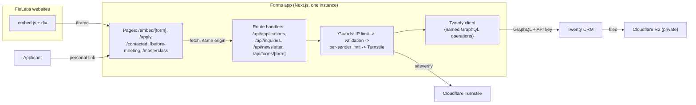

# Implementation report: FloLabs intake forms on Twenty CRM

For the team lead and future developers. It records what was built in this project from the first schema check to the production hand-over, how, why, and how it was verified. Covers tasks T1-T16, 23-24 October 2026.

Companion documents in `docs/`: `hr-guide.md` (HR hand-over), `production-launch.md` (deployment runbook), `intake-forms-spec.md` (field-level spec and decisions), `twenty-schema.md` (live Twenty API names), `implementation-plan.md` (task plan with acceptance criteria).

---

## 1. Summary

**Delivered:** one Next.js app that replaces the HubSpot forms. Every submission goes straight into the self-hosted Twenty CRM.
- **Application form:** an iframe embed on any FloLabs website, or the public link `/apply?site=<siteId>`. Creates or matches a Person, creates one Application, and uploads the CV into Twenty (storage on Cloudflare R2).
- **Forms 1, 2 and 3:** personal, signed, single-use links. Each is multi-step, with a shared header, browser drafts, and questions tailored to the applicant's programs. Each saves a Form Submission; Form 3 also saves two References.
- **Contact Us** (embed): saves an Inquiry. **Newsletter** (embed): saves consent on the Person.
- Bot protection (Cloudflare Turnstile), rate limits, retry-safe submissions, structured logs without personal data, security headers.

**State at hand-over (24 Oct 2026):**
- 304 unit tests pass (12 live tests skipped without credentials); lint, type check and production build are clean; `npm audit` shows 0 vulnerabilities.
- Live checks against Twenty passed for every form.
- Not yet deployed: see `production-launch.md`.

## 2. Starting point

**Inputs** (kept in `docs/source/`):
- the original briefs ("Form Integration AI Briefing", "Application Form Connection Details");
- the HubSpot field list (`FloLabs_Form_Fields.txt`);
- the question templates for Forms 1-3;
- four ERD screenshots.

**Fixed constraints from the briefs and `CLAUDE.md`:**
- Next.js + TypeScript.
- The browser never calls Twenty; only server routes do, through a client with named operations only.
- One Zod schema per form, shared by browser and server.
- Turnstile and rate limits run before any Twenty call.
- Retry protection with a client `submissionKey`.
- Logs carry IDs and codes only.
- No schema change in Twenty without explicit approval.
- No application code before the live schema was verified (T1 gate).

**Twenty at the start:**
- 5 People, 1 Application, 1 Site.
- Custom objects Application (Person + Site relations) and Site.
- 39 programs in "Position Applied For" and 18 sources.

## 3. Architecture



**Stack** (pinned): Next.js 16.4.3 (App Router, Turbopack), React 19.3.1, TypeScript 6.0.3, Zod 4.6.7, Vitest 5.0.5, ESLint 9.39.5, libphonenumber-js 1.13.15, Node 24.

**Repository layout** (`flolabs-intake-handoff/`):

| Path | What it holds |
|---|---|
| `src/server/` | Server-only code (`import 'server-only'`): `env.ts` (validated settings), `logger.ts` (allow-listed fields), `errors.ts` (public error mapper), `rate-limit.ts` (limits + client IP), `turnstile.ts`, `public-post.ts` (shared guards, capped body reads, single-flight and keyed queue), `sites.ts` (site rule) |
| `src/server/twenty/` | Twenty client: `findSiteByKey`, `findPersonByEmail`, `createPerson`, `updatePerson`, `uploadFile`, `findApplicationBySubmissionKey`, `createApplication`, `findApplicationForLink`, `findFormSubmissionFor`, `findFormSubmissionBySubmissionKey`, `createFormSubmission`, `findReferenceFor`, `createReference`, `findInquiryBySubmissionKey`, `createInquiry` |
| `src/server/applications/`, `inquiries/`, `newsletter/`, `people/` | Handlers per form; Person find-or-create with the fill-empty rule |
| `src/server/forms/` | `link-tokens.ts` (HMAC links), `open-link.ts` (link gate), `submit-link-form.ts` (Forms 1-3 endpoint) |
| `src/shared/config/` | Programs and tracks (40 → 5), sources (26), countries, consent wording, embed form settings; `link-forms/` = the Form 1-3 question configs |
| `src/shared/forms/` | Zod schemas (Application, Contact Us, Newsletter, link forms, phone, CV); `engine/` = the form engine |
| `src/app/` | Pages, route handlers, shared UI (`_components/`: `LinkForm`, `LinkGate`, `LinkFormPage`, drafts, Turnstile, form CSS); `dev/` pages (development only) |
| `public/embed.js` | Loader that turns `<div data-flolabs-form>` into an auto-resizing iframe |
| `scripts/` | Schema probe and approved schema-change scripts (T1-T2e), `make-form-link.mts`, `run-live-write.mjs` |
| `docs/` | Spec, plan, schema map, snapshots, runbook, HR guide, this report |

**Request flow on every public POST:**
1. Per-IP limit (50 / 10 min).
2. Size-capped body read and schema validation, with field errors.
3. Per-sender limit (5 / 30 min per email, or per Application for Forms 1-3).
4. Turnstile siteverify. It fails closed and checks the widget action for each form.
5. Twenty.

The same `submissionKey` returns the original record. Concurrent requests share one in-flight job (single-flight); Forms 1-3 also queue per link.

## 4. What was done, task by task

| Task | Result | Commit |
|---|---|---|
| **T1** Verify the Twenty schema | Read-only probe (`scripts/t1-schema-probe.mjs`) → `docs/twenty-schema.md` + JSON snapshot. Found: REST filters break on `)` and `,` (so GraphQL with variables is used); the API supports file upload into a FILES field (CV path A). Data Model permission was missing at first, then granted. | `fbfc2ec` |
| **T2a** Application schema (approved at Checkpoint A) | Added `BACKEND_DEVELOPER_INTERN` (40 programs, live labels kept), `source` stays single choice with 26 options (8 added, labels cleaned, values unchanged), "Position Applied For" relabelled "Programs Applied For", `submissionKey` added. Verified by snapshot diff. | `fbfc2ec` |
| **T3** Scaffold + typed client | Next.js app, env validation, IDs-only logger, error mapper, GraphQL client with named operations; unit + live read-only tests. | `71fec4d` |
| Sites | 16 FloLabs Site records created (`scripts/t2-sites.mjs`); `flomad` inactive. Delivery model corrected (which forms embed, which are links). | `bd46615` |
| **T4** Config + Application schema | One program→track map, 26 sources, countries, consent wording (approved); Application Zod schema (phone to E.164, LinkedIn host check, Other/Referral rules). | `aa09d89` |
| **T5** `POST /api/applications` | Person find-or-create (fill-empty only), one Application with all programs, Site, consents; `submissionKey` idempotency. Live run created test Application `7ca6ccf2…`; a retry returned the same id. Site status fields (T2c) added on approval. | `5a648e7` |
| **T6** `/apply` page | Inline errors, error summary, conditional fields, programs grouped by track; cream white #FCFBF4 interface. | `ff421cf` |
| **T6c** CV upload | Multipart request; file-signature check (PDF / DOCX), 5 MB cap; upload via `createFileUpload` → PUT → `completeFileUpload` before any record is written; upload host allow-list. Live: download identical, unsigned URL returns 403, renamed .exe refused. T6d (overlay viewer) not needed. | `eaf18d3` |
| **T7** Turnstile + rate limits | Server-side siteverify, fails closed, action checked; limits per IP and per email (5 / 30 min, approved); in-flight lock per key. | `bcf4986`, `0460d1c` |
| **T2b/T2d**, **T6b**, **T8**, **T9** | Inquiry object + Person consent fields + Inquiry site fields; `embed.js` + `/embed/[form]`; Newsletter (single opt-in, approved wording) and Contact Us. Embedding allowed on **any HTTPS website**; unknown/inactive/missing sites recorded and marked, never refused. | `882fc95`, `c673bc3`, `469598f` |
| **T2e**, **T10**, **T11** | Form Submission and Reference objects; signed links (HMAC-SHA256, single use; 21-day expiry added in the pre-launch fixes) with `npm run make-link`; form engine (sections per applicant, cross-track merge, track statements, pre-fill, answers schema, markdown summary, typed fields). | `ce94adc` |
| **T12-T14** Forms 1-3 | Question configs from the source templates + spec section 8 (all 40 programs); `POST /api/forms/<form>`; UI with browser drafts (approved); Form 3 saves References first, the Form Submission last. | `dc1a422` |
| UX iterations | Applicant-facing titles ("Tell Us More About You", "Getting Ready for Your Orientation", "Final Steps Before Your Interview"); multi-step Forms 1-2, then Form 3; step names "Interest" / "Thought and Feedback"; back arrow; new look (white card, blue accent, option boxes, error icons); shared header on every step. | `c646fa4`, `5051036`, `859520b`, `7e29d74` |
| Live verification | After the team lead granted object permissions: Contact Us and Forms 1-3 written and read back in Twenty (see section 7). | `17837b2` |
| **T15** Security pass | See section 6. | `f7012bf` |
| Launch runbook, rate limit | `docs/production-launch.md`; per-IP limit raised to 50 / 10 min (FloLabs decision), one `RATE_LIMITS` constant. | `1055ecb`, `340fc64` |
| **T16** Documentation | This report, `hr-guide.md`, the runbook updated for the GitHub repository. | `ac4f833` |
| Pre-launch fixes (project lead, 26 Oct) | One canonical site registry (`src/shared/config/sites.ts`) used by the CSP and `t2-sites.mjs`; missing / unknown / inactive sites refused before any Twenty write (`SITE_NOT_ALLOWED`); `/embed/*` frameable only by the 16 www origins; Form 1-3 links expire after 21 days (`EXPIRED` / `LINK_EXPIRED`); production port 3001 in the runbook; `TWENTY_BASE_URL` may be `http://127.0.0.1` / `http://localhost`, and the CV upload accepts Twenty's own address. | (this commit) |

## 5. Twenty schema changes (all approved before applying)

Each change was made by a script in `scripts/` through GraphQL `/metadata`. A snapshot was taken before and after and the two diffed: only the planned changes, nothing deleted or renamed.

| Script | Change |
|---|---|
| `t2a-apply.mjs` | Application: program `BACKEND_DEVELOPER_INTERN`; 8 new sources + cleaned labels; "Programs Applied For" label; `submissionKey` |
| `t2-sites.mjs` | 16 Site records |
| `t2c-site-status.mjs` | Application: `siteStatus` (KNOWN / MISSING / UNKNOWN / INACTIVE), `siteKeyReceived` |
| `t2b-inquiry-consent.mjs` | Inquiry object; Person: `communicationConsent`, `communicationConsentAt`, `consentVersion`, `communicationConsentSite` |
| `t2d-inquiry-site-status.mjs` | Inquiry: `siteStatus`, `siteKeyReceived` |
| `t2e-form-submission-reference.mjs` | Form Submission (answers RAW_JSON, answersSummary RICH_TEXT, 8 typed filter fields, tracks, formType) and Reference objects |

Twenty-specific findings that shaped the code:
- Updating a select field replaces its whole option list, so existing options are re-sent with their ids.
- Option labels may not contain commas: the business track is "Business Management / Growth & Entrepreneurship" in Twenty, and the still-interested options are "Yes definitely" / "Yes but I have questions".
- New objects are not covered by a role's per-object permissions until an admin adds them.
- `createdBy` is set to the API key's name ("Application Form Integration", accepted).
- `answersSummary` accepts `{ markdown }`.

## 6. Security and privacy

| Risk | Measure | Where |
|---|---|---|
| Spam and bots | Turnstile on every form (server-side, fails closed, per-form action); limits 50 per IP / 10 min and 5 per sender / 30 min | `turnstile.ts`, `rate-limit.ts` |
| Duplicates and races | `submissionKey` stored on every record; single-flight per key; per-link queue for Forms 1-3 | handlers, `public-post.ts` |
| Forged or reused links | HMAC-SHA256 token bound to Application + form, constant-time compare; single use enforced by an existing Form Submission; rotating `LINK_TOKEN_SECRET` revokes unused links | `link-tokens.ts`, `open-link.ts` |
| Bad input | One Zod schema per form, shared by browser and server; GraphQL variables only (no injection) | `src/shared/forms` |
| Oversized requests | Hard cap on body reads, whatever Content-Length says (T15) | `readBodyCapped` |
| Malicious files | PDF/DOCX by file signature, 5 MB cap, safe file label; upload host allow-list (no SSRF) | `applications/cv.ts`, `twenty/client.ts` |
| Injected content for HR | Applicant text markdown-escaped and links normalised in `answersSummary` (T15) | `engine/answers.ts` |
| Framing and XSS | CSP (self + Turnstile; no plugins; base-uri/form-action locked), HSTS, Permissions-Policy, nosniff; only `/embed/*` frameable, and only by the 16 FloLabs `https://www.` origins; React escaping, no raw HTML | `next.config.ts` |
| Data leaks | Logs: allow-listed IDs, codes and numbers only (runtime redaction); generic public errors; no CORS headers | `logger.ts`, `errors.ts` |
| Misconfiguration | Production refuses to start without Turnstile keys, `LINK_TOKEN_SECRET` and `TRUSTED_IP_HEADER`; `.env*` ignored by git | `env.ts`, `.gitignore` |
| Dependencies | `npm audit` 0 vulnerabilities; registry signatures verified | T15 |

**Privacy notes:**
- Applicants' unsent answers stay in their own browser only (drafts, with a "Clear my draft" link).
- Consents are stored with their wording version.
- A retention and deletion policy is still for FloLabs to set.

## 7. Verification

**Automated tests:** 24 test files, 304 tests (`npm test`), covering among other things:
- each schema rule and message;
- the site rule;
- idempotency and race behaviour;
- rate limits and the guard order (no Twenty call before the link, limit and Turnstile checks);
- log redaction;
- token tamper, reuse and wrong-form cases;
- the form engine, including cross-track merges and every program's question count;
- drafts;
- capped body reads;
- markdown escaping.

**Live checks:**
- `npm run test:live`: read-only, 7 tests; config checked against live Twenty options.
- `npm run test:live-write`: writes records, one-shot per test Application.

| Live result (24 Oct 2026) | |
|---|---|
| Application + CV (T5, T6c) | Created; retry returned the same record; CV downloads identical; unsigned URL 403 |
| Newsletter (T8) | Consent stored on the Person; repeat sign-up was a no-op |
| Contact Us (T9) | One Inquiry linked to Person and Site (status New, Known); retry returned the same record |
| Forms 1-3 (T12-T14) | Each link opened, one Form Submission saved with summary, tracks, version and filter fields; retry returned the same record; a second send got 409; the link then showed "already sent". Form 3 saved two References (phone parts stored, empty phone accepted) before the submission |
| Production build (T15) | Security headers present on every route; `/dev/*` 404; no CSP violations in a browser; Turnstile works under the CSP |

**UI:** checked in headless Chrome at desktop and phone widths, including step navigation, Back, draft restore after reload, and option boxes.

## 8. Decisions log

| Date | Decision |
|---|---|
| 23 Oct | Work starts with T1 (read-only schema verification) |
| 24 Oct, Checkpoint A | Source = single choice, 26 options; live program labels kept, Backend Developer Intern added; no Subscription object, consents stay separate on Application; `answersSummary` markdown next to raw `answers`; links never expire, single use; "roles" → programs, "schools" → tracks; reference known-duration options 0-6 m / 6-12 m / 1-2 y / 2-3 y; POC starts with the Application form |
| 24 Oct | `submissionKey` field; SMS opt-in checkbox; Newsletter consent on Person (field names approved); "Programs Applied For" label |
| 24 Oct | Records show "Application Form Integration" as creator (API key name); never odd/placeholder names on records |
| 24 Oct | Consent wording approved (safe sender, marketing, SMS, newsletter) |
| 24 Oct | Interface colour cream white #FCFBF4; email limit 5 per 30 minutes |
| 24 Oct | Site rule for all forms: Known / Missing / Unknown / Inactive, key as received kept |
| 24 Oct | Application, Contact Us and Newsletter embed as iframes in a section of **any HTTPS website**; `/apply` link kept |
| 24 Oct | Newsletter single opt-in for now; double opt-in with Amazon SES documented as future step |
| 24 Oct | Draft saving in the applicant's browser (Forms 1-3) |
| 24 Oct | Applicant-facing form titles; multi-step Forms 1-3; step names "Interest" / "Thought and Feedback"; Form 3 steps Self-assessment / References / Contacting your references; shared header on every step; design inspired by the reference form |
| 24 Oct | Form order not enforced; Amazon SES out of scope (later automation) |
| 24 Oct | Per-IP limit 50 per 10 minutes |
| 24 Oct | Branch `develop` (work) and `main` (production); public repository `at-an/FloLabs_Intake_Forms`; commits keep the author's own email; internal briefs and schema snapshots stay in the repository |
| 26 Oct (project lead) | **Replaces three 24 Oct decisions:** only known, active sites are accepted (missing / unknown / inactive refused); only the 16 FloLabs www origins may embed; Form 1-3 links expire after 21 days. Forms app on `127.0.0.1:3001`, Twenty stays on 3000; `TWENTY_BASE_URL=http://127.0.0.1:3000` allowed |
| Open | Data retention policy; production hosting choice (recommended: Twenty's droplet, one instance, behind Cloudflare) |

Implementation choices recorded in the spec for confirmation:
- the writing sample and portfolio are links only, with no file upload;
- choosing "Other" in the robotics tools list shows a required text field;
- the Journalism question "Share a link…" stays a text answer;
- Form 3 also keeps the two references in its raw answers.

## 9. Problems met and how they were solved

| Problem | Resolution |
|---|---|
| REST metadata returned 403 (no Data Model permission) | Schema read through GraphQL `/metadata`; permission granted later for the approved changes |
| REST record filters break on `)` and `,` | All record access through GraphQL with variables |
| Zod 4 skips object-level checks after a type error elsewhere | Cross-field rules moved to field-level transforms or `refine(..., { when })`; friendly message on every field |
| `next start` returned 500 locally | Production mode requires real Turnstile keys (by design); local testing uses `npm run dev` or test keys passed explicitly |
| Twenty rejects commas in option labels | Labels adjusted in Twenty only (see section 5) |
| A probe call created the `tracks` field early with one option | My mistake; completed immediately with `updateOneField` (the field was empty) and reported |
| New objects returned FORBIDDEN | The API key's role lacked object permissions; the team lead granted them |
| Live write test run before permissions existed | My mistake; it stopped at the first forbidden read. Records' update times confirmed nothing was written |
| Form 3 live test hit Vitest's 5 s default timeout | Live tests allow 30 s; only Form 3 re-run (`-- -t MASTERCLASS`); nothing had been half-saved |
| Email in the identity card wrapped mid-word | Column sized to content, break only when needed |
| Error summary repeated "Please answer this question." | Each item now names its question |
| Ending Node processes for a test also stopped every other Node process | Processes are now stopped by port only |

## 10. Known limitations and future work

**Limitations:**
- **One app instance:** rate limits and the per-link queue are in memory. A shared store such as Redis is the upgrade path.
- **CSP and inline scripts:** the CSP allows inline scripts (Next.js bootstrap). Per-request nonces would remove this.
- **Links:** Form 1-3 links expire 21 days after they are created and work once; rotating the secret revokes all unused ones. HR asks the tech team for them.
- **Websites:** only the 16 listed www origins may embed the forms; a bare (non-www) domain or a new website needs a code change and a release (project lead's approval).
- **Newsletter:** single opt-in.

**Future work, in a sensible order:**
1. **Link creation for HR:** a link generator HR can use without the tech team, for example a protected admin page.
2. **Automatic emails with Amazon SES:**
   - Form 1-3 links;
   - Newsletter double opt-in: a pending consent until the confirmation link is clicked, a Pending / Confirmed / Unsubscribed status, and an unsubscribe link.
3. **Pipeline automation:** Lead Status changes when forms arrive, and optional rules for the form order.
4. **Data retention:** automatic deletion after the period FloLabs sets.
5. **Shared rate-limit store** if more than one instance is ever needed.

## 11. Test records to delete before go-live

All are in Twenty. Keep them until FloLabs says to delete them; then delete in this order: References → Form Submissions → Inquiry → Applications → Person.

| Object | Ids |
|---|---|
| Person "Atankeu Natanahel" (`zoom+t5test@flomadlabs.com`, also carries a test newsletter consent) | `86cb22e6-d19a-41fe-a82b-9b89cb044692` |
| Applications | `7ca6ccf2-2aa0-478b-a76d-c655a6f2037f` (T5), `503ae559-7e05-42b7-8c79-dc3632633b2f` (T6c, with CV) |
| Inquiry | `9c68df1c-baf8-4da5-8aec-4370333066e3` |
| Form Submissions | `158a6ca6-5847-4ba6-8b54-6bb1d855e605` (Form 1), `3fddecad-c73d-4e6a-95f5-bab491d0e8b1` (Form 2), `365a333b-8cd2-4588-852a-0c03e3fcc293` (Form 3) |
| References | `45fb6d96-82a7-40d7-a023-557d05f4436c`, `5eb218e3-fa1a-4da0-846c-fb4a25a1d41f` |

## 12. Working on the code

```bash
cd flolabs-intake-handoff
npm ci
cp .env.example .env.local      # fill in TWENTY_API_KEY etc. (never commit)
npm run dev                     # http://localhost:3000/apply, /dev/embed-test, /dev/link-form
npm test && npm run lint && npm run typecheck && npm run build
npm run test:live               # read-only checks against Twenty
npm run make-link -- <applicationId> contacted     # a Form 1 link (local)
```

**Changing questions:**
- Edit `src/shared/config/link-forms/*.ts` and bump that form's `version`; the engine and the tests pick it up.
- A program or source change must match the Twenty option **values**; a live test checks this.

**Branches:** work on `develop` through pull requests; release by a pull request `develop` → `main` plus a tag (see the runbook).
