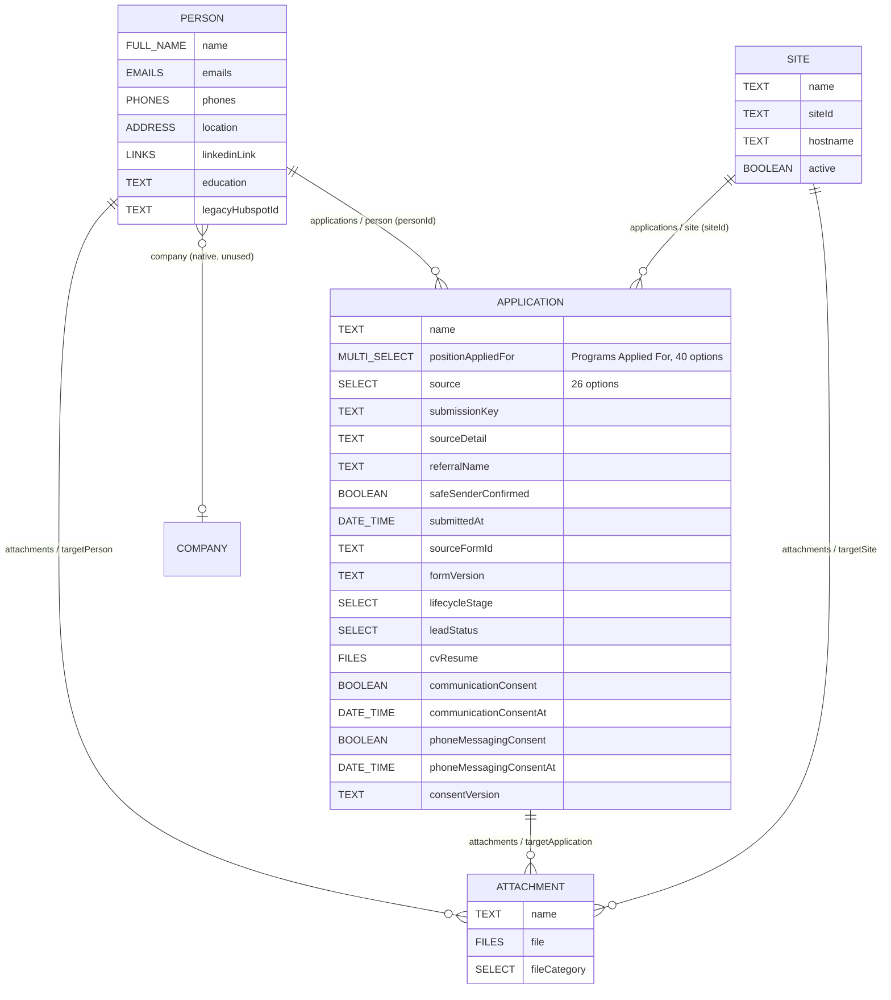

# Twenty schema map (T1)

Verified against the live instance on 2026-10-23 (`https://157-230-82-204.sslip.io`); updated after T2a on 2026-10-24.
Machine-readable snapshots: `docs/snapshots/twenty-schema-2026-10-23.json` (T1) and `docs/snapshots/twenty-schema-2026-10-24-t2a.json` (current; field ids, options, relations).
Re-generate with `node --env-file=.env.local scripts/t1-schema-probe.mjs <out.json>` from `flolabs-intake-handoff/`.

Live data at verification time: 5 People, 1 Application, 1 Site, 0 Attachments.

## Current structure (live)

People also carry Twenty's native activity relations (notes, tasks, timeline, calendar, messages, opportunities, list memberships); Applications and Sites have notes, tasks and timeline.

## API access with the current key

| Endpoint | Result | Use |
|---|---|---|
| REST records `/rest/<plural>` | 200 | Record reads/writes. Not used by the app: the `filter` parser fails on `)` and `,` even inside quotes (T3) |
| GraphQL records `/graphql` | 200 | Record reads/writes. **Used by the app** (values as variables) |
| REST metadata `/rest/metadata/objects` | 200 (403 until 2026-10-24) | Schema reads and changes (T2) |
| GraphQL metadata `/metadata` | 200 | Schema reads, file upload mutations |
| OpenAPI `/rest/open-api/core` | 200 | Per-object request/response schemas |

Schema changes go through GraphQL `/metadata` (`updateOneField`, `createOneField`); see `scripts/t2a-apply.mjs`. Updating a select field's `options` replaces the whole list, so existing options must be re-sent with their ids.

## Write formats (composite fields)

Values are API values, never UI labels.

| Twenty type | Write shape |
|---|---|
| FULL_NAME | `{ firstName, lastName }` |
| EMAILS | `{ primaryEmail, additionalEmails: [] }`. Person.emails has `maxNumberOfValues: 1` |
| PHONES | `{ primaryPhoneNumber, primaryPhoneCountryCode, primaryPhoneCallingCode, additionalPhones: [] }`. Person.phones has `maxNumberOfValues: 1` |
| LINKS | `{ primaryLinkUrl, primaryLinkLabel, secondaryLinks: [] }` |
| ADDRESS | `{ addressStreet1, addressStreet2, addressCity, addressState, addressPostcode, addressCountry }` (also addressLat/Lng) |
| SELECT | one value string, e.g. `"OTHER"` |
| MULTI_SELECT | array of value strings, e.g. `["UI_UX_DESIGN_INTERN", "FINANCE_INTERN"]` |
| FILES | array of `{ fileId, label }` (response adds `extension`, `url`) |
| RELATION (many-to-one) | set the join column: `personId`, `siteId` |

To confirm with a test write in T5: exact `addressCountry` format (country name vs ISO code) and `primaryPhoneCountryCode` (ISO "US" vs calling code).

## Person (`person` / `people`)

| Spec field | API name | Type | Notes |
|---|---|---|---|
| First/Last Name | `name.firstName` / `name.lastName` | FULL_NAME | |
| Email | `emails.primaryEmail` | EMAILS | match key |
| Phone | `phones` | PHONES | |
| Country / State / City | `location.addressCountry` / `.addressState` / `.addressCity` | ADDRESS | label "Location" |
| LinkedIn URL | `linkedinLink.primaryLinkUrl` | LINKS | label "Linkedin" |
| Education/Major | `education` | TEXT | |
| (relation) | `applications` | RELATION one-to-many -> `application.person` | |
| (relation) | `attachments` | RELATION one-to-many -> `attachment.target` | |
| (other, unused) | `legacyHubspotId`, `jobTitle`, `company`/`companyId`, `avatarFile` | | |

## Application (`application` / `applications`)

| Spec field | API name | Type | Notes |
|---|---|---|---|
| (label identifier) | `name` | TEXT | Display name in the UI. Value to be decided in T5 |
| Programs Applied For | `positionAppliedFor` | MULTI_SELECT | label "Programs Applied For" (T2a), 40 options, see below |
| How did you hear about us? | `source` | SELECT | single value, 26 options (T2a), see below |
| Submission key | `submissionKey` | TEXT | added in T2a, field id `e1fd1843-ca3c-4b38-8c79-c46b34483170`; retry protection (spec D8) |
| Source Detail | `sourceDetail` | TEXT | exists |
| Referral Name | `referralName` | TEXT | exists |
| Safe-sender confirmation | `safeSenderConfirmed` | BOOLEAN | default false |
| Submitted At | `submittedAt` | DATE_TIME | |
| Source Form ID | `sourceFormId` | TEXT | |
| Form Version | `formVersion` | TEXT | |
| Lifecycle Stage | `lifecycleStage` | SELECT | `INTERESTED` |
| Lead Status | `leadStatus` | SELECT | `UNCONTACTED`, `CONTACTED`, `BEFORE_MEETING` |
| CV | `cvResume` | **FILES** | label "CV / Resume", `maxNumberOfValues: 10`, field id `b0449d1e-9e4f-42e5-8ba2-f53b9c4f8de8` |
| Person | `person` / `personId` | RELATION many-to-one -> `person.applications` | onDelete SET_NULL |
| Site | `site` / `siteId` | RELATION many-to-one -> `site.applications` | onDelete SET_NULL |
| Attachments | `attachments` | RELATION one-to-many -> `attachment.target` | |
| Marketing/newsletter consent | `communicationConsent`, `communicationConsentAt` | BOOLEAN / DATE_TIME | kept and used (spec D5) |
| SMS/phone consent | `phoneMessagingConsent`, `phoneMessagingConsentAt` | BOOLEAN / DATE_TIME | kept and used (spec D5) |
| Consent wording version | `consentVersion` | TEXT | |

### positionAppliedFor options (live)

Values are the API values to send. Decision (2026-10-24): live labels are kept; the third column shows the earlier spec proposal, now superseded. `BACKEND_DEVELOPER_INTERN` "Backend Developer Intern" was added in T2a (last position).

| Value | Live label (kept) | Earlier spec proposal (superseded) |
|---|---|---|
| `AI_AGI_INTERN` | AI/AGI Intern | **AI/AGI Developer Intern** |
| `BACKEND_DEVELOPER_INTERN` | Backend Developer Intern | = (added in T2a) |
| `FRONT_END_DEVELOPER_INTERN` | Front-end Developer Intern | **Front-End Developer Intern** |
| `JOURNALISM_PR_INTERN` | Journalism & PR Intern | **Journalism and PR Intern** |
| `PODCAST_PRODUCTION_INTERN_POSITION` | Podcast Production Intern Position | **Podcast Production Intern** |
| `PRODUCT_DEVELOPMENT_INTERN_AI_ROBOTICS` | Product Development Intern (AI & Robotics) | **Product Development Intern (AI and Robotics)** |
| `ANIMAL_SCIENCE_AND_VETERINARY_RESEARCH_INTERN` | Animal Science and Veterinary Research Intern | = |
| `BIOMEDICAL_ENGINEERING_INTERN` | Biomedical Engineering Intern | = |
| `BUSINESS_DEVELOPMENT_AND_SALES_INTERN_AI_AND_ROBOTICS` | Business Development and Sales Intern (AI and Robotics) | = |
| `COMPUTER_VISION_ENGINEERING_INTERN` | Computer Vision Engineering Intern | = |
| `CONTENT_MARKETING_INTERN` | Content Marketing Intern | = |
| `CONTROL_SYSTEMS_ENGINEERING_INTERN` | Control Systems Engineering Intern | = |
| `DIGITAL_MARKETING_INTERN` | Digital Marketing Intern | = |
| `EDTECH_AND_INNOVATION_INTERN` | EdTech and Innovation Intern | = |
| `EMBEDDED_SYSTEMS_INTERN` | Embedded Systems Intern | = |
| `ETHICAL_AND_LEGAL_RESEARCH_INTERN` | Ethical and Legal Research Intern | = |
| `FINANCE_INTERN` | Finance Intern | = |
| `GTM_ENGINEER_GO_TO_MARKET_ENGINEER_INTERN` | GTM Engineer (Go-To-Market Engineer) Intern | = |
| `GTM_INFLUENCER_INTERN` | GTM Influencer Intern | = |
| `HOSPITALITY_AND_TOURISM_INTERN` | Hospitality and Tourism Intern | = |
| `HUMAN_ROBOT_INTERACTION_INTERN` | Human-Robot Interaction Intern | = |
| `MACHINE_LEARNING_ENGINEERING_INTERN` | Machine Learning Engineering Intern | = |
| `MARKETING_INTERN` | Marketing Intern | = |
| `MECHATRONICS_ENGINEERING_INTERN` | Mechatronics Engineering Intern | = |
| `NEUROSCIENCE_INTERN` | Neuroscience Intern | = |
| `OPERATIONS_INTERN` | Operations Intern | = |
| `PROJECT_MANAGEMENT_INTERN` | Project Management Intern | = |
| `PROMPT_ENGINEER_INTERN` | Prompt Engineer Intern | = |
| `QUALITY_ASSURANCE_INTERN` | Quality Assurance Intern | = |
| `QUANTUM_ENGINEER_INTERN` | Quantum Engineer Intern | = |
| `RESEARCH_ASSOCIATE_INTERN_OPEN_SOURCE_PROJECTS` | Research Associate Intern (Open-Source Projects) | = |
| `ROBOTICS_ENGINEERING_INTERN` | Robotics Engineering Intern | = |
| `SENSOR_INTEGRATION_INTERN` | Sensor Integration Intern | = |
| `SEO_SPECIALIST_INTERN` | SEO Specialist Intern | = |
| `SOCIAL_MEDIA_INTERN` | Social Media Intern | = |
| `SOFTWARE_DEVELOPMENT_INTERN` | Software Development Intern | = |
| `SPACE_SCIENCE_INTERN` | Space Science Intern | = |
| `SPORT_SCIENCE_INTERN` | Sport Science Intern | = |
| `TECHNICAL_WRITING_INTERN` | Technical Writing Intern | = |
| `UI_UX_DESIGN_INTERN` | UI/UX Design Intern | = |

### source options (live, SELECT, after T2a)

`INDEED_COM` "Indeed", `GLASSDOOR_COM` "Glassdoor", `GOOGLE_COM` "Google", `FACEBOOK_COM` "Facebook", `INSTAGRAM_COM` "Instagram", `LINKEDIN_COM` "LinkedIn", `SIMPLYHIRED_COM` "SimplyHired", `NORTHEASTERN_UNIVERSITY_S_INTERNAL_JOB_PORTAL` "Northeastern University's Internal Job Portal", `AUSTIN_COMMUNITY_COLLEGE` "Austin Community College", `TEXAS_A_M_UNIVERSITY_CORPUS_CHRISTI` "Texas A&M University-Corpus Christi", `TEXAS_A_M_UNIVERSITY_KINGSVILLE` "Texas A&M University-Kingsville", `JACKSON_COLLEGE` "Jackson College", `PURDUE_NORTHWEST` "Purdue Northwest", `CENTRAL_GEORGIA_TECHNICAL_COLLEGE` "Central Georgia Technical College", `HANDSHAKE` "Handshake", `ALABAMA_STATE_UNIVERSITY` "Alabama State University", `WORK_UA` "Work.ua", `TIKTOK` "TikTok", `REDDIT` "Reddit", `YOUTUBE` "YouTube", `X_TWITTER` "X (Twitter)", `COMPANY_WEBSITE` "Company Website", `JOB_BOARD` "Job Board", `EVENT` "Event", `REFERRAL` "Referral", `OTHER` "Other".

T2a added TikTok, Reddit, YouTube, X (Twitter), Company Website, Job Board, Event and Referral, and relabelled the 8 ".com"/Northeastern options; values unchanged. `OTHER` stays last.

## Site (`site` / `sites`)

| API name | Type |
|---|---|
| `name` | TEXT |
| `siteId` | TEXT (site key) |
| `hostname` | TEXT |
| `active` | BOOLEAN (default true) |
| `applications` | RELATION one-to-many -> `application.site` |
| `attachments` | RELATION one-to-many -> `attachment.target` |

Records:

| id | name | siteId | hostname | active |
|---|---|---|---|---|
| `f39c8196-db3d-41ee-bc58-abfecf43933d` | FloLabs International | `flolabs_international` | www.flolabs.international | true |

## Attachment (`attachment` / `attachments`)

`name` TEXT, `file` FILES (`maxNumberOfValues: 1`), `fullPath` TEXT (legacy), `fileCategory` SELECT (`ARCHIVE`, `AUDIO`, `IMAGE`, `PRESENTATION`, `SPREADSHEET`, `TEXT_DOCUMENT`, `VIDEO`, `OTHER`), polymorphic target join columns incl. `targetApplicationId`, `targetPersonId`, `targetSiteId`.

## File upload (CV path decision)

The API supports server-side file upload through GraphQL `/metadata`:

1. `createFileUpload(filename, size, fileFolder: FilesField, fieldMetadataId: "<FILES field id>")` returns `FileUploadTarget { fileId, uploadUrl, contentType, expiresAt }`.
2. PUT the bytes to `uploadUrl`.
3. `completeFileUpload(fileId)`.
4. Write the record with `cvResume: [{ fileId, label }]` (or an Attachment with `file: [...]` + `targetApplicationId`).

**Result: path A is supported by the API.** Preferred variant: the native `Application.cvResume` FILES field (field id above), since HR sees the CV on the record itself. An Attachment record is the alternative. Not yet exercised end to end (T1 is read-only). T6c confirms with a real upload, after T6c-0 points storage at R2.

## Approved changes (spec section 7, Checkpoint A 2026-10-24)

**T2a applied on 2026-10-24** (`scripts/t2a-apply.mjs`). Verified by diffing the before/after snapshots: only the T2a changes below; no field or option removed, no value renamed, record counts unchanged.

- **T2a (POC, applied):** Application: add `BACKEND_DEVELOPER_INTERN`; 8 `source` options + label cleanup (values unchanged); relabel `positionAppliedFor` to "Programs Applied For" (API name unchanged); `submissionKey` TEXT.
- **T2b (revised POC, not applied):** `inquiry`, `formSubmission` (with `answers` RAW_JSON + `answersSummary` RICH_TEXT, which stores `{ markdown }`), `reference`. None exist yet. No `subscription` object. Person: `communicationConsent`, `communicationConsentAt`, `consentVersion`, `communicationConsentSite` for Newsletter sign-ups (names approved).

Every record gets an auto-generated `id` (UUID) from Twenty. The REST create schema does not accept a client `id`, so retry protection uses the separate `submissionKey` field.

The instance also has native `messageList` (name, description, members, campaigns), `messageListMember` (list, person) and `messageCampaign` objects (Twenty's email campaigns). They track list membership only (no consent fields), a possible target for the Newsletter later.
